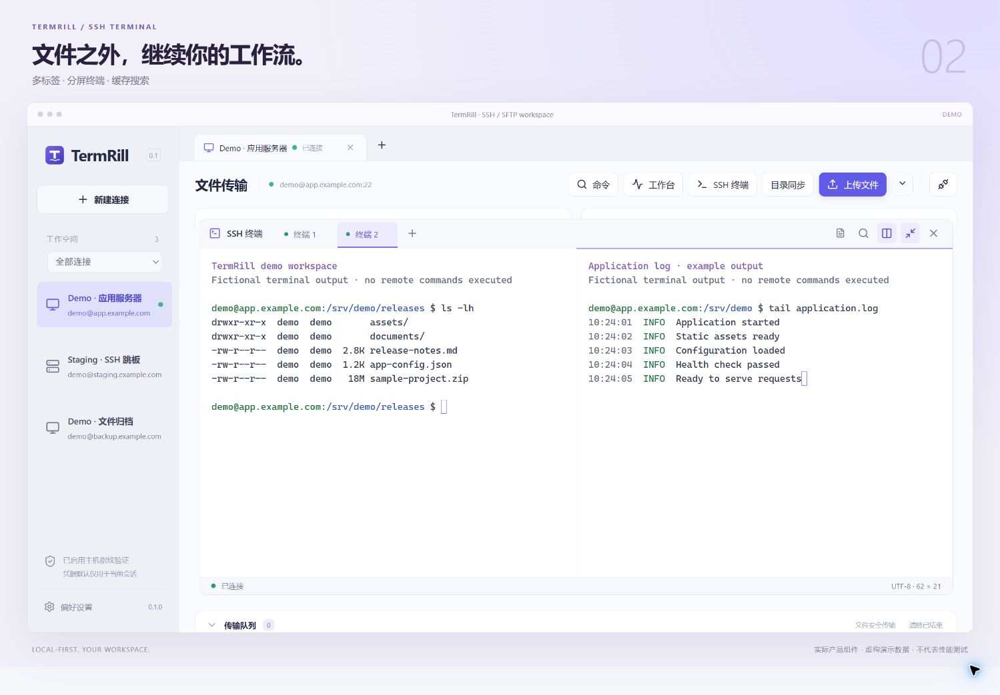
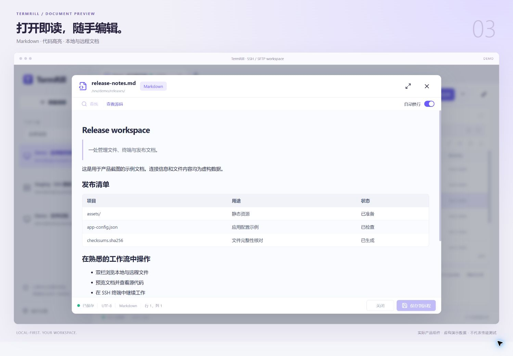
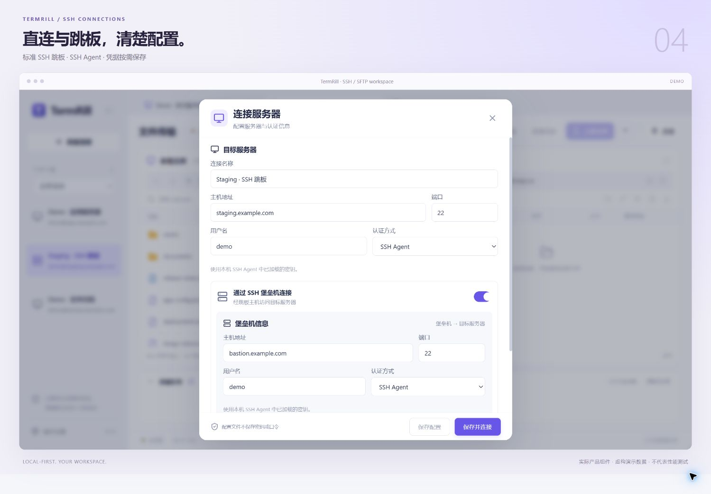

# TermRill

[](https://github.com/celerxy/termrill/actions/workflows/checks.yml)
[MIT License](LICENSE)

TermRill 是本地优先的 SSH/SFTP 桌面工作台，使用 Tauri 2、React、TypeScript 和 Rust 构建。支持多会话文件管理、可靠传输、交互终端及文档与归档预览，无需云账号。

当前为内部试用版，应用版本为 `0.2.0`。Windows 本机检查已通过；最新版安装包、真实服务器组合及 macOS/Linux 仍有待验收项目，见 [当前验证状态](docs/READINESS.md)。路线图版本是需求阶段，不表示已经发布。

## 界面预览

以下展示图直接使用当前产品组件渲染，连接、目录、终端输出和任务进度均为虚构演示数据，不代表真实服务器连接或性能测试。截图入口及复现步骤见 [展示图说明](docs/SCREENSHOTS.md)。

**双栏文件管理与传输队列**


**多标签与分屏 SSH 终端**



**Markdown 文档与源代码预览**



**标准 SSH 跳板连接配置**



## 主要能力

- SSH 直连、标准跳板、主机指纹确认、密码/私钥/Agent/交互认证，以及用户主动选择的系统凭据保存。
- 多会话双面板、本地/远程收藏和路径历史、批量重命名、属性及远程权限操作。
- 文件与目录上传下载、暂停、取消、失败重试、续传、并发及限速；覆盖前确认，失败保留旧目标或报告回滚备份。
- 多标签和分屏终端、终端搜索及有界日志持续查看。
- 多编码文本编辑、Markdown/Mermaid、Notebook、CSV/TSV、图片及 PDF、EPUB 阅读器。
- ZIP、TAR 系列、7Z 读写与密码能力；RAR 和单文件压缩流只读。
- 单向目录差异同步、规则与排除项、快速/严格比较、文本差异和任务报告。
- Linux 服务器状态、连接分组、非敏感配置导入导出和确认后执行的常用命令。

具体支持范围见 [功能矩阵](docs/SUPPORT_MATRIX.md)，操作与资源限制见 [使用指南](docs/USAGE.md)。

## 开发启动

当前说明以 Windows PowerShell 为例。在本仓库根目录运行，目录本身可以使用任意名称。

准备 Node.js/npm、Rust MSVC 工具链、Visual Studio C++ Build Tools 和 WebView2。测试依赖中的静态 OpenSSL 首次编译还需要 Windows 原生 Perl，例如 Strawberry Perl；运行应用不需要 Perl 或 OpenSSL DLL。macOS/Linux 的构建与发行尚未独立验收。

```powershell
npm install
npm run tauri dev -- --verbose
```

依赖已缓存时，可使用 `npm run tauri dev -- --offline --verbose`；首次下载 Rust 依赖时不要启用离线模式。需要代理时仅为当前终端设置实际可用的 `HTTP_PROXY` / `HTTPS_PROXY`，项目不修改全局代理。

```powershell
npm run dev
```

以上仅启动浏览器 UI 预览，地址为 `http://127.0.0.1:15420`。本地文件、SSH 和原生文件选择器需要桌面环境；页面显示不代表这些原生操作可在浏览器执行。

生产 SSH/SFTP 使用 russh/russh-sftp；ssh2 与静态 OpenSSL 保留在测试依赖中。开发模式会预热页面模块，并输出 `[TermRill dev]` / `[TermRill startup]` 耗时；这些数字不包括全部 Cargo 编译时间，也不是正式包启动承诺。

## 配置与数据

应用标识为 `dev.termrill.sftpclient`。Windows 配置目录通常为 `%APPDATA%\dev.termrill.sftpclient\`。

| 数据         | 保存位置与内容                                                                |
| ------------ | ----------------------------------------------------------------------------- |
| 连接与偏好   | `connections.json`：地址、用户名、认证方式、私钥路径、主机指纹和显示/传输设置 |
| 传输恢复     | `transfers.json` 与任务完成日志：路径、任务配置和完成摘要，不包含认证凭据     |
| 同步规则     | `sync-rules.json`：目录、方向、比较方式和排除项                               |
| 工作台       | `workbench.json`：连接分组与常用命令等；命令草稿不要包含密码或令牌            |
| 本机界面偏好 | WebView localStorage：收藏、最近目录、布局、PDF 阅读位置等非敏感偏好          |
| 已保存密码   | 用户明确选择后存入系统凭据库；默认不保存，不回退到明文配置                    |

目标和跳板分别验证指纹；首次连接或指纹变化必须确认。配置导出不包含密码、私钥内容、凭据库或主机信任，但私钥路径可能包含本地用户名，导出前应查看预览。

工程仅使用 TermRill 命名，不提供旧品牌迁入或回退入口。文件覆盖、取消与恢复的具体行为见 [使用指南](docs/USAGE.md)。

## 检查与测试

```powershell
npm run format:check
npm run build
cargo check --offline --manifest-path src-tauri/Cargo.toml
cargo clippy --offline --manifest-path src-tauri/Cargo.toml --all-targets -- -D warnings
npm test
```

完整检查统一使用 `npm run check`，依次执行 npm/Tauri/Cargo 应用版本一致性、格式、全部前端逻辑测试、前端构建、Rust check、Clippy 和本机 SSH 回归，任一步失败即停止。先准备下文 Python 环境和 Rust 依赖缓存；首次可运行 `cargo fetch --locked --manifest-path src-tauri/Cargo.toml`，后续检查使用锁文件与离线模式，不自动改写依赖。

只检查版本可运行 `npm run check:versions`。需要指定 Python 时运行 `npm run check -- -Python tests/.runtime-fixture-py312/Scripts/python.exe`。修改前阅读 [AGENTS.md](AGENTS.md)，统一格式使用 `npm run format`。

准备本机 SSH 测试服务：

```powershell
python -m venv tests/.venv
tests/.venv/Scripts/python.exe -m pip install -r tests/requirements.txt
./tests/run.ps1
```

也可指定已有环境：`./tests/run.ps1 -Python tests/.runtime-fixture-py312/Scripts/python.exe`。服务只监听本机随机端口，不访问个人服务器。测试结束删除临时数据与密钥；失败时仅在 `tests/.runtime-last-failure/` 保留服务日志。

只执行无需服务的 Rust 单元测试：

```powershell
$env:TERMRILL_TEST_MANIFEST='1'
try {
    cargo test --offline --manifest-path src-tauri/Cargo.toml --lib
} finally {
    Remove-Item Env:TERMRILL_TEST_MANIFEST
}
```

PDF 独立界面回归入口及手工步骤见 [PDF 阅读器回归](docs/PDF_READER_REGRESSION.md)。最新已执行的检查与未验收范围集中维护在 [验收记录](docs/READINESS.md)，不以构建成功替代真实环境验收。

## 打包

```powershell
npm run release:windows
# Rust 依赖已缓存时：
npm run release:windows -- -Offline
```

脚本先复用完整检查，再构建 Windows NSIS 安装包并生成 SHA256 文件；检查失败不开始打包，不自动安装或发布。输出目录为 `src-tauri/target/release/bundle/nsis/`。离线参数只限制 Cargo，首次准备 NSIS/WebView2 工具仍可能需要网络。

CI 配置位于 `.github/workflows/checks.yml`：推送、Pull Request 或手动触发时，在 Windows runner 准备依赖并调用同一完整检查入口。只使用本机随机端口的 SSH fixture，不需要私人服务器、签名或发布密钥；该工作流不生成或发布安装包。[Windows 托管检查已有通过记录](https://github.com/celerxy/termrill/actions/runs/39982783850)，最新提交状态见页首徽章和 [Actions](https://github.com/celerxy/termrill/actions/workflows/checks.yml)。

多平台测试包入口为 `.github/workflows/installers.yml`：在 GitHub 的 Actions 中选择 **Test installers → Run workflow**。它先复用完整 Windows 检查，再分别构建 Windows x64、macOS Apple Silicon/Intel 和 Linux x64 安装包，每个平台执行版本、格式、前端测试和 Rust 检查。默认只把安装包和 SHA256 上传到保留 14 天的 Artifacts；勾选 `publish_release` 后，全部平台成功且附件校验通过才发布新版本预发布 Release。macOS 使用免费 ad-hoc 签名，不等于 Developer ID 签名或公证；普通构建和预发布不需要配置 Secrets。

预发布安装包请前往 [Releases](https://github.com/celerxy/termrill/releases)。`0.2.0` 新增 EPUB 阅读器、Mac 签名改进和 Windows 安装器外观；旧版 `0.1.0` 不包含这些改进。安装、卸载与升级仍需实机验收，详细状态与步骤见 [打包与安装说明](docs/RELEASE.md)。

## 文档导航

| 文档                                      | 职责                              |
| ----------------------------------------- | --------------------------------- |
| [使用指南](docs/USAGE.md)                 | 常用流程、数据保护和资源限制      |
| [功能矩阵](docs/SUPPORT_MATRIX.md)        | 当前支持、未实现和未验收能力      |
| [验收记录](docs/READINESS.md)             | 最新验证结果、待验收项及历史记录  |
| [架构导读](docs/ARCHITECTURE.md)          | 模块、IPC、状态生命周期及实现约束 |
| [产品路线图](docs/PRODUCT_ROADMAP.md)     | 后续需求阶段，不代表发行版本      |
| [打包与安装说明](docs/RELEASE.md)         | 本地/Actions 打包与安装验收步骤   |
| [第三方许可](docs/THIRD_PARTY_NOTICES.md) | 已整理的 RAR/7Z 第三方许可文本    |

## 贡献与反馈

使用问题和功能建议请提交 [Issue](https://github.com/celerxy/termrill/issues)。参与开发前请阅读 [贡献指南](CONTRIBUTING.md) 和 [开发规范](AGENTS.md)。安全漏洞请按 [安全反馈说明](SECURITY.md) 联系维护者，不要在公开 Issue 中附带漏洞利用细节或凭据。

## 许可证

本项目代码采用 [MIT License](LICENSE)。第三方依赖仍适用各自的许可证，已整理的说明见 [第三方许可](docs/THIRD_PARTY_NOTICES.md)。
